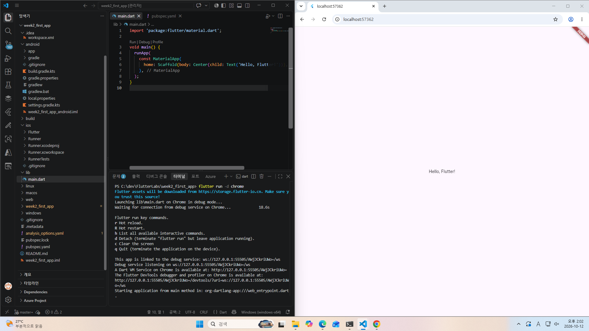

# 📝 Week 02 Evidence Pack: 첫 Flutter 앱 실행 및 환경 구성 기록

* **제출자:** [강명진] ([2023136068])
* **제출일:** 2026년 10월
* **저장소:** (https://github.com/2023136068-ai/week2_first_app.git)

---

## 1. 개발환경 체크리스트

- [x] `git --version`이 정상 실행된다.
- [x] `flutter --version`이 정상 실행된다.
- [x] `flutter doctor -v`에서 Android 개발에 필요한 상태를 설명할 수 있다.
- [x] `flutter devices`에서 사용한 실행 대상을 확인했다.

### 🔍 `flutter doctor -v` 진단 및 판단 근거

* **Visual Studio 경고:** Windows 데스크톱 C++ 빌드 환경 경고는 학습 목표인 Android/Chrome 웹 실행에 영향이 없어 건너븁니다.
* **Network resources 경고:** 해외 패키지 서버 접속 제한 에러가 발생하여, 국내 미러 서버 환경 변수(`PUB_HOSTED_URL=https://pub.flutter-io.cn`)를 설정해 해결했습니다.

---

## 2. 첫 앱 실행 결과

- **프로젝트 이름:** week2_first_app
- **수정한 문구:** Hello, Flutter!
- **실행 명령:** `flutter run -d chrome`
- **실행 대상 (Device):** Chrome (web)
- **실행 시각:** 2026년 10월
- **실행 화면 증거:**
  

---

## 3. GitHub 저장소 및 첫 Commit 정보

- **본인 소유 저장소 링크:** https://github.com/[본인 GitHub 아이디]/week2_first_app
- **첫 Commit 메시지:** `chore: verify first Flutter run`

---

## 4. 학습기록

| 항목 | 작성 내용 |
|---|---|
| **목표** | Chrome 웹 브라우저 및 Android 실행 환경에서 첫 Flutter 앱을 성공적으로 띄우고 실행 증거를 남기려 했습니다. |
| **관찰** | `flutter doctor -v` 실행 시 Android toolchain은 정상 동의되었으나 `pub.dev` 네트워크 소켓 연결 에러가 발견되었습니다. |
| **원인** | 해외 패키지 서버(`pub.dev`) 접속 제한으로 인해 필수 기본 패키지(`flutter_lints`) 수신이 멈췄던 것이 원인이었습니다. |
| **행동** | Windows 사용자 환경 변수에 공식 Flutter 미러 서버(`https://pub.flutter-io.cn`)를 설정하고 `flutter clean` 후 `flutter pub get`을 재실행했습니다. |
| **결과** | 패키지가 정상 수신되어 `Got dependencies!`를 확인했고, `flutter run -d chrome`으로 앱 화면 출력에 성공했습니다. |
| **다음** | 3주차에 진행될 Flutter 프로젝트 디렉터리 내부 구조와 요구사항 컨텍스트 설계를 미리 살펴볼 예정입니다. |